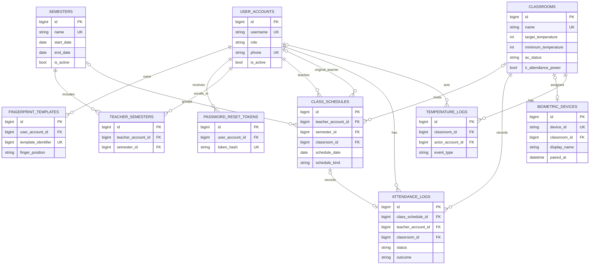
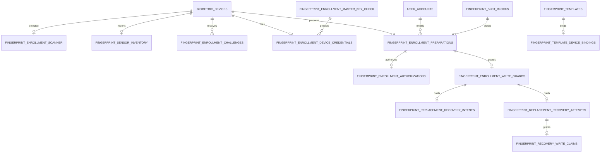

# Data model and table relationships

This document describes the MariaDB schema defined by migrations `001`–`041`
in the repository as of 2026-11-08. An installation may be on an older schema;
check `schema_versions` before relying on a table or column. The diagrams show
the most useful **declared foreign-key relationships**, not every field,
index, historical identity, or application validation. See
[Migrations](../Migrations/) for authoritative SQL and
[Portal process flow](./PORTAL_PROCESS_FLOW.md) and
[Firmware process flow](./FIRMWARE_PROCESS_FLOW.md) for behavior.

## Conventions and interpretation

- Solid Mermaid ER relationships below represent database foreign keys. A
  child with `device_id` does **not** necessarily reference the same kind of
  identifier: most device foreign keys are numeric `biometric_devices.id`,
  while the external scanner ID `biometric_devices.device_id` is a string.
- Some completion and binding records intentionally retain identifiers without
  a database foreign key. They are described as **logical references** rather
  than drawn as foreign keys.
- MariaDB uniqueness, nullability and deletion policies are defined in the
  migrations; important application-level checks such as schedule overlap,
  active sessions, write guards and safe re-pairing add further restrictions.
  An ER line is not permission to delete or alter a record.
- Attendance and temperature event timestamps are treated by the application as
  **school-local wall time**, despite legacy `_utc` column names. Do not apply
  a UTC conversion based only on the name. Authentication expiry, challenge
  and audit timestamps are UTC as implemented by their respective stores.
- Database mappings identify sensor slots; physical biometric templates remain
  on the scanner sensor. Neither a mapping nor an IR command receipt proves a
  physical outcome.

## Core academic and attendance relationships

`CLASS_SCHEDULES.classroom_id`, `semester_id`, and `original_teacher_account_id`
are nullable in the schema. `attendance_logs.class_schedule_id` is nullable
and unique when present; its schedule FK uses `ON DELETE SET NULL`. A generated
unique active-session key prevents more than one open attendance row per
teacher. `teacher_semesters` uniquely pairs a teacher and semester. A nullable
unique device classroom assignment allows unassigned devices while enforcing
at most one assigned scanner per classroom. Finger positions are unique per
user and slot identifiers are globally unique in `fingerprint_templates`.

| Table | Purpose and important details |
|---|---|
| `schema_versions` | Applied migration version keys and script names. |
| `user_accounts` | Administrators and teachers, profile, role, activity and password hash; later migrations add admin device PIN hash. |
| `password_reset_tokens` | Hashed one-use expiring web-password reset tokens, FK to account. |
| `semesters` | Named date ranges and active flag. |
| `teacher_semesters` | Teacher-to-semester enrollment; unique pair. |
| `classrooms` | Room, capacity, desired target, teacher minimum, recorded AC status and optional current-temperature field; target is not a measurement. |
| `class_schedules` | Dated class, teacher, room, optional semester, subject, time and Regular/Makeup kind. Recurrences are expanded into rows. |
| `attendance_logs` | Schedule-linked or standalone attendance with teacher, room, status, punch-time storage and outcome. Absence and automatically closed missing time-outs must not be interpreted as physical punches. |
| `fingerprint_templates` | User/finger-to-sensor-slot mappings, not sensor model bytes. |
| `biometric_devices` | Internal row ID, external numeric-string scanner ID, generated display name, pairing, nullable room, polling and feature controls. |
| `temperature_logs` | Room events, optional actor, target and optional measured value. |
| `teacher_requests`, `support_tickets` | Legacy schema tables with account relationships; the current UI does not expose a leave/request or support-ticket workflow. Their existence does not imply those features are active. |

`teacher_requests` has teacher, optional substitute and reviewer FKs;
`support_tickets` has teacher and optional reviewer FKs. They are omitted from
the main diagram for readability.

## Device authentication, OTP, IR and buzzer

```mermaid
erDiagram
    BIOMETRIC_DEVICES ||--o| FACULTY_OTP_DEVICE_LIMITS : limits
    BIOMETRIC_DEVICES ||--o| FACULTY_OTP_REQUESTS : has
    USER_ACCOUNTS ||--o{ FACULTY_OTP_REQUESTS : requests
    USER_ACCOUNTS ||--o{ PORTAL_MOBILE_OTP_REQUESTS : initiates
    BIOMETRIC_DEVICES ||--o| FACULTY_DEVICE_SESSIONS : has
    USER_ACCOUNTS ||--o{ FACULTY_DEVICE_SESSIONS : uses
    BIOMETRIC_DEVICES ||--o{ AC_IR_BOOTS : registers
    BIOMETRIC_DEVICES ||--o| AC_IR_STATE : maintains
    CLASSROOMS ||--o{ AC_IR_STATE : relates
    BIOMETRIC_DEVICES ||--o{ AC_IR_RECONCILIATIONS : has
    CLASSROOMS ||--o{ AC_IR_RECONCILIATIONS : has
    USER_ACCOUNTS o|--o{ AC_IR_RECONCILIATIONS : confirms
    BIOMETRIC_DEVICES ||--o| BUZZER_TEST_REQUESTS : queues

    FACULTY_OTP_REQUESTS {
        bigint device_id PK,FK
        bigint teacher_id FK
        binary phone_key
        binary code_tag
        datetime expires_utc
    }
    PORTAL_MOBILE_OTP_REQUESTS {
        bigint actor_id PK,FK
        string purpose PK
        bigint target_id PK
        binary phone_key
        binary code_tag
        datetime expires_utc
    }
    FACULTY_DEVICE_SESSIONS {
        bigint device_id PK,FK
        bigint teacher_id FK
        binary token_hash
        datetime expires_utc
    }
    AC_IR_BOOTS {
        bigint device_id PK,FK
        binary boot_id PK
    }
    AC_IR_STATE {
        bigint device_id PK,FK
        bigint classroom_id FK
        string state
        int assumed_temperature
        bool assumed_power
        bool command_power
        int protocol_version
    }
    AC_IR_RECONCILIATIONS {
        bigint id PK
        bigint device_id FK
        bigint classroom_id FK
        bigint admin_account_id FK
        bool assumed_power
    }
    BUZZER_TEST_REQUESTS {
        bigint device_id PK,FK
        datetime paired_at
        datetime expires_utc
    }
```

| Table | Purpose |
|---|---|
| `gsm_modem_settings` | Singleton server-side modem port and baud rate. It does not configure the scanner's GSM UART. |
| `faculty_otp_phone_limits` | Rate window keyed by a keyed phone digest; no database FK to an account. |
| `faculty_otp_device_limits` | Per-device rate window; device FK and primary key. |
| `faculty_otp_requests` | At most one current request per device, teacher FK, phone digest, code tag, delivery state, expiry and failed attempts. |
| `portal_mobile_otp_limits` | Per-actor and per-number request windows keyed by digests. |
| `portal_mobile_otp_requests` | One pending portal verification per actor, purpose and target; keyed phone digest, code tag, delivery state, expiry and attempts. `target_id` is not a declared FK. |
| `faculty_device_sessions` | At most one current scanner-bound session per device, teacher FK, token hash, phone digest, pairing snapshot and expiry. |
| `ac_ir_boots` | Composite device/boot history used to distinguish scanner boots. |
| `ac_ir_state` | Current per-device room, boot, protocol version, `reconcile`/`ready`/`inflight` state, assumed temperature and power, and possible claimed step or toggle. |
| `ac_ir_reconciliations` | Admin confirmation history, including optional assumed power, with device and room FKs and an optional admin FK. `boot_id` is stored, not declared as a composite FK to `ac_ir_boots`. |
| `buzzer_settings` | Singleton global enabled/lead/repeat settings. |
| `buzzer_test_requests` | One pending test per scanner; pairing snapshot and 30-second expiry. A claim removes the request. |

Reminder times are derived from settings, schedules and active attendance; they
are not stored as a separate reminder-event table. A claim or an IR state
transition is not proof of sound or physical AC reception.

## Fingerprint enrollment and guarded writes

The scanner selector is a singleton row with a non-null device reference;
when no device is selected, the row can be absent. Inventory,
credentials, authorizations and guards use their device or preparation keys to
limit the corresponding records. Guards and blocks express unresolved work, not
proof that the sensor has or has not stored a model.

| Table | Purpose |
|---|---|
| `fingerprint_enrollment_scanner` | Singleton administrator-selected scanner. |
| `fingerprint_slot_blocks` | Slot identifiers excluded from attendance matching while unsafe or reserved. |
| `fingerprint_enrollment_preparations` | Exact scanner, teacher, finger and blocked slot; optional replacement template identifier added by migration 025. Unique constraints prevent conflicting preparation. |
| `fingerprint_enrollment_challenges` | Hashed single-use, expiring authentication challenges associated with a device and operation. |
| `fingerprint_enrollment_authorizations` | Time-limited admin consent for a preparation/operation; consent alone is not a write grant. |
| `fingerprint_enrollment_write_guards` | Durable unresolved write guard tied to a preparation and operation. |
| `fingerprint_template_device_bindings` | FK to a finalized template and a logical external device-ID string; **no FK to `biometric_devices`**. The binding persists independently of device deletion. |
| `fingerprint_enrollment_completions` | Durable ordinary-enrollment receipts keyed by operation, with preparation/device identifiers and later-added slot. Receipt identities are logical references, not FKs. |
| `fingerprint_enrollment_master_key_check` | Singleton validation record for configured server master key. |
| `fingerprint_enrollment_device_credentials` | Protected scanner key material, with FKs to device and master-key check. |
| `fingerprint_sensor_inventory` | Latest authenticated scanner capacity and bitmap snapshot; freshness and invalidation are enforced by the application. |

### Replacement and recovery records

These are experimental, separately gated operations. Presence of tables does
not mean every recovery path is connected or safe to enable.

| Table | Purpose / relationship |
|---|---|
| `fingerprint_replacement_guard_authorizations` | Replacement-specific consent snapshot tied by FK to the unresolved guard. |
| `fingerprint_replacement_write_claims` | One-use original replacement write claims, FK to guard. |
| `fingerprint_replacement_write_fences` | Retires the original replacement write path, FK to guard. |
| `fingerprint_replacement_recovery_intents` | Guard-bound, time-limited recovery intent; not a write grant. |
| `fingerprint_replacement_recovery_attempts` | Guard-bound unresolved recovery attempt. |
| `fingerprint_recovery_write_claims` | Recovery write claim, FK to the recovery attempt. |
| `fingerprint_recovery_attempt_fences` | Retired recovery-attempt identities, FK to guard. |
| `fingerprint_recovery_intent_history` | Previously issued recovery identities retained while the guard is held, FK to guard. |
| `fingerprint_replacement_completions` | Replacement completion receipts; identifiers are retained logical references, not declared FKs. |
| `fingerprint_recovery_completions` | Recovery completion receipts; identifiers are retained logical references, not declared FKs. |

The guarded records and device's local journal work together to prevent unsafe
replay. Do not delete guards, claims, fences, blocks or journals manually to
force progress. Consult the current detailed protocol and operational limits in
the [main README](../README.md#device-fingerprint-api).

## Reading and maintaining these diagrams

Mermaid-capable Markdown viewers render the ER diagrams above. They deliberately
omit standalone singleton and audit/receipt tables from ER lines when no
declared FK exists. The optional/one/many notation depicts schema relationships,
not whether a user is allowed to perform an operation. Whenever a migration
changes a key, relationship or table, update this document alongside the SQL
and application logic.
