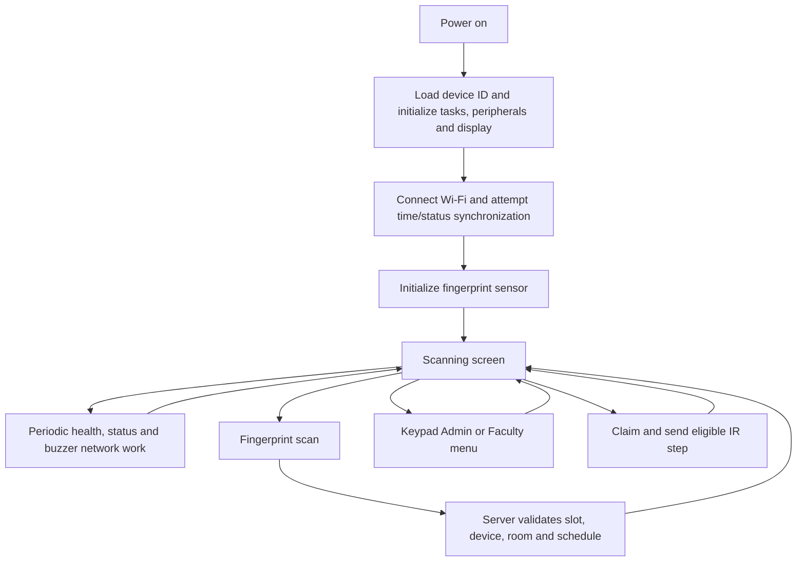

# Firmware process flow

This describes the companion `SmartClassAC-ESP32\smartclass` source at version
`1.6.63` as inspected on 2026-11-08. It does not assert that this version is
compiled, flashed, or validated on a particular scanner. The portal workflows
are described in [Portal process flow](./PORTAL_PROCESS_FLOW.md), and storage
relationships in [Data model and relationships](./DATA_MODEL.md).

## Hardware and boundaries

| Component | Source configuration / role |
|---|---|
| ESP32 | Runs the scanner sketch and stores pairing and protected write journal in preferences/NVS. |
| Fingerprint sensor | UART2: ESP RX GPIO16, ESP TX GPIO17, 57600 baud; models are on the sensor, not the portal. |
| 4×3 keypad | Rows GPIO14, 32, 33, 26; columns GPIO27, 12, 25. |
| I2C LCD | 16-column interface for scanning, menus, notices and status. |
| DHT22 | GPIO4; local display temperature is not confirmed AC setpoint. |
| Passive buzzer | GPIO13; use a compatible driver. Never connect a low-impedance speaker directly to a GPIO. |
| IR emitter | GPIO23, `IRremoteESP8266`; relative NEC temperature-up/down and opt-in power toggle. Verify the module is a transmitter and electrically compatible. |
| Optional AC relay | `AC_RELAY_PIN = -1` by default, so no physical relay output is enabled by that setting. |
| GSM UART | Diagnostic wiring uses ESP RX GPIO18 and TX GPIO19; the portal's SMS modem is a separate server-side connection. |

The diagnostic receiver is a **separate sketch and device**, not the scanner:
the companion `ir_receiver_diagnostic` listens on GPIO13 and can show codes on
an IdeaSpark ST7789 display. Its reception does not verify that the real AC
received or acted on a command.

## Boot and runtime

The scanner attempts Wi-Fi, time synchronization, health and room-status
restoration during boot, then verifies the fingerprint sensor. A failed
fingerprint handshake stops the device rather than entering normal scanning.
The source has a manual `GSM` serial diagnostic; automatic GSM startup checking
is currently commented out.

In normal operation:

- Health, device status, and buzzer requests run through a background polling
  task so periodic network waits do not normally block keypad entry. If task
  creation fails, an error is logged and polling falls back to blocking calls.
  User-initiated network actions and some other operations may still block.
- Health checks are scheduled about every 30 seconds; device-status polling
  uses the server-provided interval (5–3600 seconds); buzzer checks are
  scheduled about every 5 seconds. Actual timing depends on network and other
  work.
- Wi-Fi loss clears online status and triggers reconnection and status
  restoration when connectivity returns. A status response supplies room,
  AC state, target and enabled scan/enrollment controls.
- IR polling remains on the normal scanning loop; it is not part of the
  background network task.

## Pairing and administrator menu

On the ready screen press `#`. In lists use `*`/`#` to move, tap `0` to
select, and hold `0` to go back. In number entry, use digits, `*` to delete
or go back when empty, and `#` to submit.

The administrator enters the server-validated device admin PIN. Pairing uses
a separate one-time code generated in the portal; on success the scanner saves
the generated device ID to NVS. A paired admin can choose an available room or
unassign the scanner, subject to server restrictions. Assigning a room is not
proof that the sensor contains the correct templates.

Source 1.6.62 offers pairing-code entry if the server rejects a saved device ID
as unknown or inactive during admin authentication. Check that the device and
its assigned room are active on the intended portal first. Pairing still
requires the server to validate the admin PIN and one-time code. A pending,
unreadable, or corrupt enrollment journal, an installed enrollment key, or a
storage error blocks entry; do not erase storage to bypass these safeguards.

Source 1.6.63 adds **Admin → Unpair device** after server-validated admin access.
Press `#` to confirm or `*` to cancel. This is local-only: it removes the saved
device ID, not the portal pairing, room assignment, sensor fingerprints or AC
power state. An installed enrollment key, nonempty/unreadable journal, or storage
failure blocks it. After local unpairing, generate a fresh pairing code in the
portal and pair again; local unpairing does not revoke server credentials.

## Attendance scanning

1. In scanning mode the fingerprint sensor matches an enrolled physical
   template and returns a slot ID; the scanner sends that ID and its device ID
   to `/api/device/fingerprint/scan`.
2. The server checks device, room, scanner-bound or legacy mapping, teacher,
   and schedule eligibility and returns the attendance/AC action.
3. The scanner displays the returned teacher name and result or denial, updates
   its local room/relay state where applicable, and returns to scanning.
4. A second eligible scan can end an active session; an eligible in-window
   re-entry can reopen it. The server, not the sensor, determines attendance
   and schedule rules.

Sensor models do not synchronize automatically. Legacy mappings can be global
and are unsafe to assume portable across scanners. New completion bindings
restrict a mapping to its scanner, but do not replicate a model.

## Faculty menu and SMS OTP

1. Select Faculty and enter the 11-digit mobile number; the scanner requests an
   OTP through the server. The server's GSM transport, not the scanner buzzer
   or TFT receiver, sends the SMS.
2. Enter the six-digit OTP. The scanner verifies the authenticated server
   response before granting menu access. The server limits requests and guesses;
   OTPs expire after five minutes and are single-use.
3. The five-minute scanner-bound session provides today's schedule and room AC
   information. On schedule, `*` and `#` navigate, `0` toggles detail, and
   holding `0` returns. In AC info, `*` lowers and `#` raises the target by one
   degree, `0` refreshes, and holding `0` returns.
4. Saving a target is not a transmission or AC confirmation. Exit the Faculty
   menu to return to scanning, where IR polling can resume.

These features require the server OTP, menu and target flags as applicable,
matching per-device key provisioning, and correct HTTPS or trusted Development
configuration. If the result of a target request is uncertain, reopen AC info
to refresh rather than blindly retrying.

## Relative IR synchronization

1. The paired, connected scanner registers a new boot with the server.
2. The admin sets the physical AC to the current portal target and confirms
   reconciliation for that boot and room.
3. While on the normal scanning screen, the scanner checks for pending steps
   at a five-second interval. Network requests and other scanner work add
   latency. Every degree is a separate authenticated claim and completion.
4. A successfully claimed step sends NEC 32-bit `0x08E7A857` for up or
   `0x08E7906F` for down on GPIO23. These are relative commands, not a measured
   setpoint or power on/off command.
5. The scanner reports completion. An uncertain claim or completion halts IR
   processing; restart and reconcile rather than guessing or replaying.

The feature is separately gated by `AcIr:EnableDeviceApi`; matching the IR
protocol and electrical emitter to the actual AC remains a hardware
responsibility. A receiver diagnostic or a successful server receipt does not
establish that the AC received or applied the signal.

Power control is additionally gated by portal `AcIr:EnablePowerToggle` (default
off) and scanner compile flag `AC_IR_POWER_ENABLED` (enabled by default in source
1.6.60). The v2 scanner uses distinct authenticated routes and cannot synchronize
IR until the portal power flag is enabled; enabling it disables the legacy IR
routes for all scanners. After a fresh boot, the admin must verify and confirm the
physical ON/OFF state and target. Attendance demand can then claim one NEC
`0x08E700FF` toggle; no separate ON or OFF signal exists. Temperature steps
wait while assumed power is off. An uncertain claim or completion halts further
IR until restart and physical reconciliation. A remote control or missed signal
can invalidate the assumed state; neither IR transmission nor the diagnostic
receiver confirms what the AC actually did. Source 1.6.60 has not been uploaded
or hardware-tested.

## Buzzer

The server calculates schedule reminders only for an active attendance session
in the device's assigned room. The scanner polls the v2 buzzer endpoint and
suppresses a repeated reminder ID during the same boot. A claimed test and a
reminder in the same response share the playback path. The current source
plays a five-second, ten-note melody on GPIO13 using a separate task.

Reminders have a 20-second server window and are not replayed after an outage;
reboot within a reminder window can repeat one. Tests expire in 30 seconds and
are claimed at most once. Network and scanner delays can cause either to be
missed; the claim is not proof of audible output.

## Experimental fingerprint writes

`ENROLLMENT_WRITES_ENABLED` defaults to `1` in source 1.6.61; inventory
reporting is enabled by the same flag. `REPLACEMENT_WRITES_ENABLED` remains `0`.
The server independently gates inventory, operation, claim, finish, recovery,
and replacement endpoints. A preparation or consent does not alone authorize a
sensor write. In an explicitly enabled deployment, the scanner checks the
sensor slot and verified authorization, persists an uncertainty journal before
the write, and requires a checked acknowledgment and authenticated completion
before clearing it. Same-slot replacement has additional guards and flags.

Uncertain writes and lost responses can leave the journal, server guard and
slot block held. Do not clear them manually or assume staged recovery endpoints
provide an automatic retry. See the detailed limitations in the
[main README](../README.md#device-fingerprint-api).

## Serial diagnostics and deployment

Use Serial Monitor at 115200 baud with Newline or Both NL & CR. `HELP` lists
commands; `STATUS` prints firmware/network/device status and refreshes server
state; `HEALTH` checks the portal; `GSM` runs modem diagnostics; `ENROLL` is
gated; and `DELETEALL` is a destructive sensor-clear operation subject to
journal and server safeguards. Do not run destructive commands merely as a
diagnostic. Do not share PINs, tokens, phone numbers, passwords, or keys.

Building or changing source does not install firmware. Select the correct
board and libraries, build and upload to the intended scanner, then validate
connectivity, pairing, attendance, and permitted hardware behavior. Updates
restart the scanner and require IR reconciliation. The separate receiver
sketch must be uploaded to the receiver board, not the production scanner.
