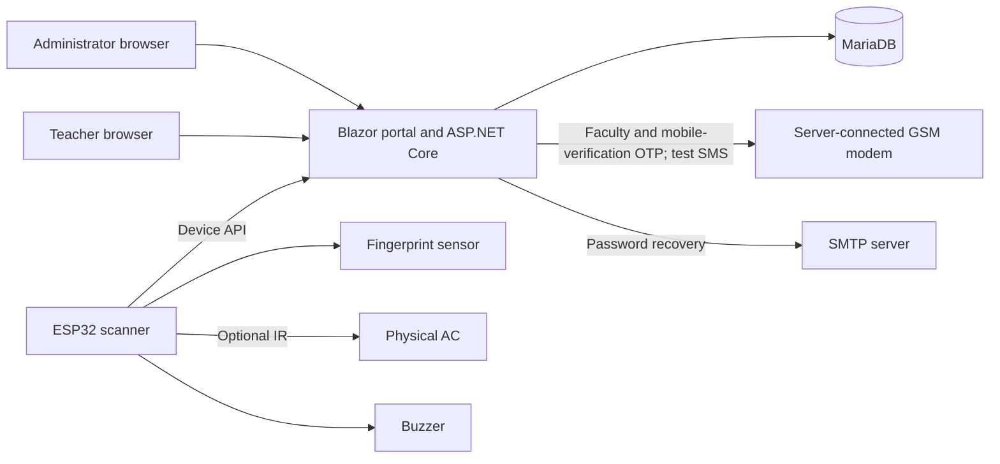
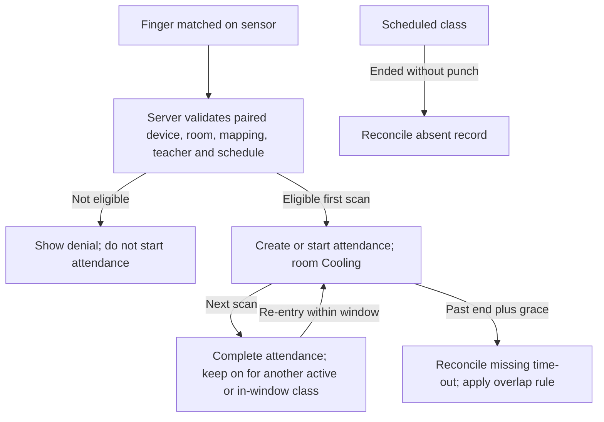

# Portal process flow

This document describes the portal implementation in the repository as of
2026-11-08. It is a guide to the **source**, not confirmation that a particular
server, configuration, migration, scanner, or physical AC has been deployed or
tested. For scanner details see [Firmware process flow](./FIRMWARE_PROCESS_FLOW.md);
for tables and diagrams see [Data model and relationships](./DATA_MODEL.md).
The [main README](../README.md) contains setup, deployment, configuration,
endpoint details, and extensive notes on experimental fingerprint protocols.

## System overview

The portal is a .NET 8 Blazor Server application. Authentication uses cookies
and role authorization; MariaDB holds portal data. A device uses the fleet
device API key, while sensitive experimental operations additionally use a
provisioned per-device key, short-lived challenges, and authenticated
responses. These mechanisms do not themselves encrypt network traffic.

## Startup and access

1. Configure the MariaDB connection, initial administrator credentials, device
   API key, school time zone, and any optional services using protected
   configuration. Do not copy secrets into documentation or share them in logs.
2. The hosted initialization service attempts migrations in numerical order,
   initializes the administrator and optional development demo data, and retries
   failures. After repeated database failures it logs an error and the portal can
   start in a degraded state. `schema_versions` tracks applied migrations.
3. If first-access setup is required, the administrator completes the recovery
   email setup before signing in. The login endpoint verifies the password and
   creates a role-bearing authentication cookie. Admin and Teacher pages
   require their respective roles. Password recovery uses a one-use expiring
   token and configured SMTP delivery.
4. The attendance reconciliation service runs approximately once per minute;
   attendance reads and scan workflows also invoke reconciliation where needed.

## Administrator workflow

The Admin sidebar exposes Overview; Management (Teachers, Semesters,
Classrooms, Devices, Schedules); Operations (AC control, Attendance); and
System (GSM settings, Buzzer settings, System settings).

### Prepare people, rooms, and schedules

1. Create teachers with their identity, required mobile number and account
   details; active status controls eligibility. Registration requires a real
   SMS code sent to the proposed number. Admin or teacher mobile changes require
   another SMS code; unchanged numbers do not. This uses a separate portal OTP
   lifecycle from the Faculty device OTP and requires the configured GSM modem
   and `FacultyOtp:Secret`. Failed or uncertain delivery cannot authorize a save.
2. Create and activate a date-ranged semester, then enroll teachers in it.
3. Create classrooms, including capacity, target temperature and the teacher's
   minimum permitted temperature.
4. Create Regular or Makeup schedules for an eligible teacher, semester and
   classroom. Recurrence expands into individual dated rows through the
   semester end; conflicting dates are skipped and reported. Individual
   schedules can be moved or deleted subject to validation and active-session
   restrictions. Makeup schedules are preferred when applicable schedules
   overlap.
5. Before retiring a classroom, resolve its current and future schedules.
   Device assignment is managed separately.

### Register and pair scanners

1. Register a device under **Devices**. Its generated numeric device ID and
   `Device N` display name are stable across room changes. A device may be
   unassigned; at most one scanner is assigned to a classroom.
2. Configure its active state, room, status polling interval, attendance scan
   and enrollment permissions. Assignment, deactivation and certain changes
   can be blocked by an active class or unresolved protected operation.
3. Set the six-digit **device admin PIN** in System settings and generate a
   one-time pairing code in Devices. The PIN is distinct from the pairing code.
4. On the scanner choose Admin, enter the PIN and pairing code; the server
   validates them and the scanner persists its issued device ID. Pairing
   attempts are rate limited. A lost or consumed code may require a new one.
5. Once connected, the device fetches its assigned room and settings at boot
   and periodically. The device retains its own network credentials, portal
   address, and API key; those are not downloaded from the portal.

### Fingerprint preparation and guarded enrollment

Normal sensor writes are enabled by default in scanner source 1.6.61 but remain
subject to the guarded workflow and independent portal gates. The legacy
`/api/device/fingerprint/enroll` endpoint is disabled. Preparing a slot,
selecting a scanner, or granting consent does not itself write a fingerprint.

The experimental flow, when explicitly enabled and correctly provisioned, is:

1. The admin selects an eligible enrollment scanner and prepares a finger for
   an active teacher. Automatic allocation depends on a recent authenticated
   sensor inventory; a slot is reserved and blocked from attendance matching.
2. A short-lived admin consent identifies the exact intended operation. The
   scanner independently checks eligibility and sensor occupancy, captures the
   finger, and authenticates a challenge-bound claim.
3. The server consumes consent and creates a durable write guard. The scanner
   journals the uncertain write before the sensor operation, verifies a checked
   acknowledgment, and records confirmation locally.
4. A separately authenticated completion creates the scanner-bound mapping and
   completion receipt. The scanner clears its journal only after verifying the
   appropriate signed receipt or supported recovery result.

Lost responses, power failure, or uncertain sensor writes can leave a guard,
block and journal unresolved. Do **not** manually delete them to retry or clear
the sensor. Same-slot replacement is a separate, independently gated flow;
some recovery and fencing components are staged and not an end-to-end
automatic recovery. See the [main README's detailed enrollment section](../README.md#device-fingerprint-api)
before enabling any experimental flags.

### AC control and attendance

An admin can view and change classroom targets and request AC on/off state.
The portal's state is a desired/recorded state, not independent evidence that
the physical AC changed. Teacher target changes are restricted to an active
class and the classroom minimum.

The IR synchronization feature is separately gated and experimental. After a
scanner boot, an admin must set the **actual AC** to the portal target using its
remote before confirming **Reconcile**. The scanner claims and sends relative
one-degree steps; an uncertain claim or completion stops further steps until
restart and reconciliation. The emitted signal does not confirm AC reception,
power state, or actual temperature.

Optional attendance power control uses a separate, default-off v2 protocol.
After a fresh scanner boot, the admin must also select the AC's physically
verified ON/OFF state. A single `0x08E700FF` toggle is claimed before sending;
missed reception or manual remote use can invalidate the assumption. Restart
and reconcile after uncertainty. Enabling the portal flag disables legacy IR
routes globally, so every scanner must first be upgraded to matching firmware.
Remote and Override controls do not request IR power toggles.

Under **Attendance**, an admin can view records and create a report with an
inclusive date range and optional teacher, room and outcome filters. Print/PDF
uses the browser print dialog; Excel downloads a workbook. Report exports use
all matching records, not only the current page. For a schedule-linked row the
report date is the schedule date; otherwise it is the recorded school-local
time-in date. Reconciliation happens before report generation.

### GSM, buzzer, and system settings

- **GSM settings:** select and save the server's serial modem port and baud
  rate. A confirmed test SMS is a real send and may incur charges. Modem
  acceptance is not proof of handset delivery; an uncertain send should not be
  blindly retried.
- **Buzzer settings:** configure the global enable flag, lead and repeat
  intervals (1–180 minutes). Defaults introduced by migration 040 are enabled,
  15 minutes before end and every 5 minutes. Only an active attendance session
  in the assigned room qualifies, strictly before scheduled end. A reminder has
  a 20-second delivery window and is not replayed after an outage.
- **Test buzzer:** queue one request for an active paired scanner, independently
  of reminder enablement. It expires after 30 seconds, can be claimed at most
  once, and is invalidated by re-pairing. Queueing or claiming does not prove a
  sound played. Firmware 1.6.56+ plays the five-second melody; older compatible
  firmware uses short tones.
- **System settings:** includes the device admin PIN and administrative reset
  controls. Reset is destructive and protected operations may prevent it.

## Teacher workflow

There is no teacher web portal; only administrators can sign in to the web
application. Teachers use an enrolled finger on a scanner to record attendance.
The scanner's separate Faculty menu can provide schedule and AC functions when
its feature flags are enabled. Temperature target changes require an eligible
active class and respect the room minimum. A displayed target is not a
measurement.

The scanner's separate Faculty menu authenticates using a mobile number and SMS
OTP, not the web password. OTP issuance, menu access and scanner target changes
have separate server feature flags. A valid OTP creates a short-lived,
scanner-bound session for schedule browsing and AC information. See
[Firmware process flow](./FIRMWARE_PROCESS_FLOW.md#faculty-menu-and-sms-otp).

## Attendance and room state

Attendance status is `Active` or `Completed`; outcomes include `OnTime`,
`Late`, `Absent`, and `MissingTimeOut`. The default late and missing-time-out
grace periods are each 15 minutes, configurable through `SchoolTime`.
An early logout excludes the ending class's own remaining window when deciding
whether to turn off; another active or in-window class keeps it on. Re-entry
reopens attendance even when the room is already Cooling. Reconciliation clears
attendance power once no active session or in-window schedule remains. Generated absence or missing-time-out
records do not represent actual physical punches. Early dismissal, overtime,
leave, and attendance-exception workflows are not implemented as outcome flows.

## Integration and safety boundaries

| Surface | Relevant behavior |
|---|---|
| `/health` | Reports application/database health; it is not proof a scanner or AC is reachable. |
| `/api/device/status` | Provides room state, configuration and pending sensor-clear request. |
| `/api/device/fingerprint/scan` | Resolves a sensor slot within device/room and eligibility rules. |
| `/api/device/admin/*` | Pairing, room selection and assignment use the device API key and admin PIN. |
| `/api/device/faculty/*` | OTP/menu routes are gated; authenticated operations use a per-device key and challenge. |
| `/api/device/ac-ir/*` | Separately gated relative-step protocol; reconciliation and fail-closed handling apply. |
| `/api/device/buzzer[/v2]` | Reminder polling; v2 additionally claims test requests. |
| Attendance report routes | Require an active administrator. |

Use HTTPS outside Development for protected device routes. Development HTTP
is only appropriate on a trusted LAN and exposes sensitive traffic. Feature
flags, server and firmware versions, key provisioning, and physical hardware
must all match before a workflow can be relied upon.
