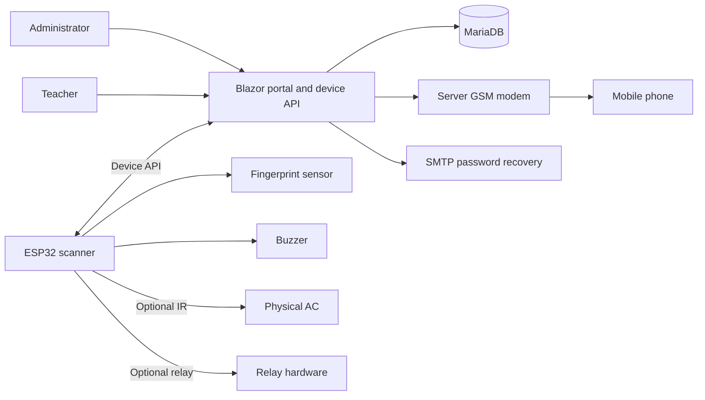
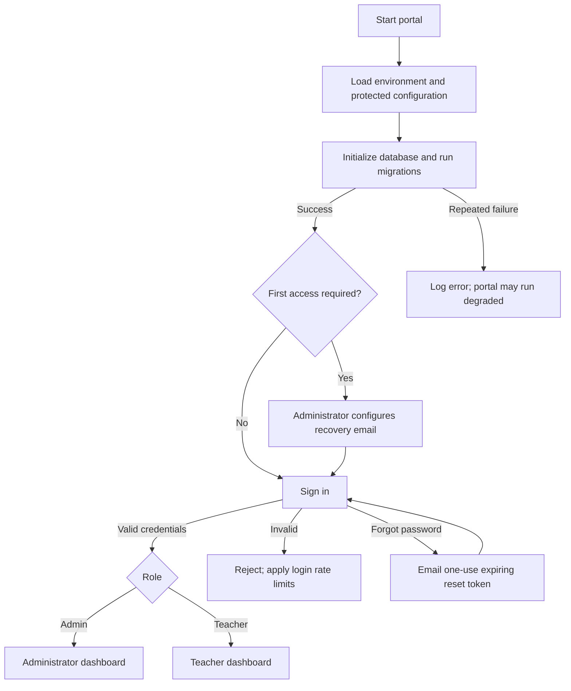
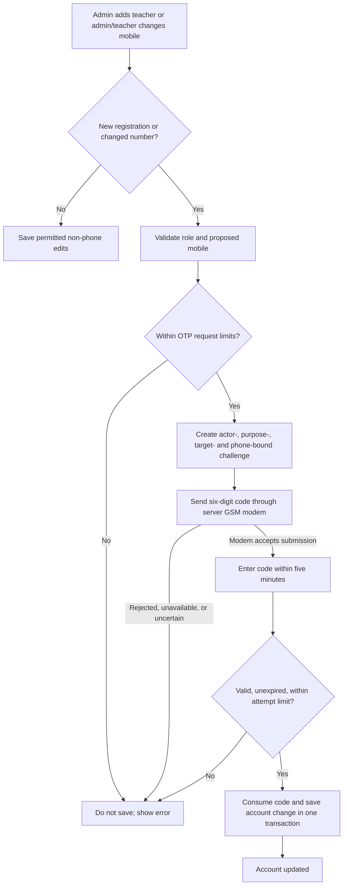
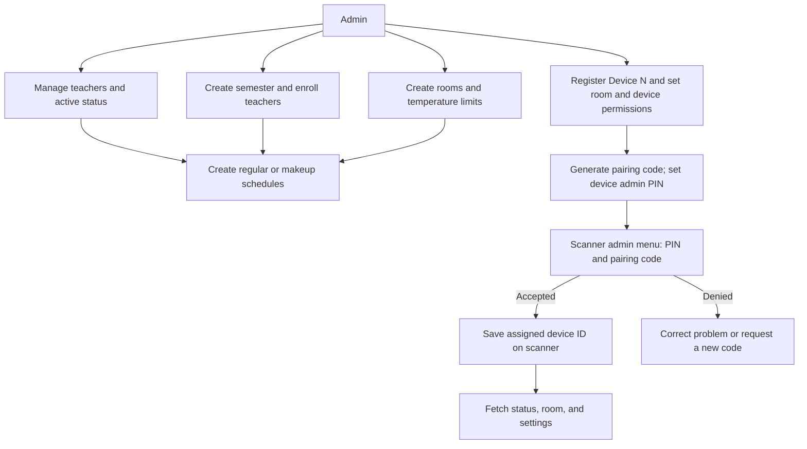
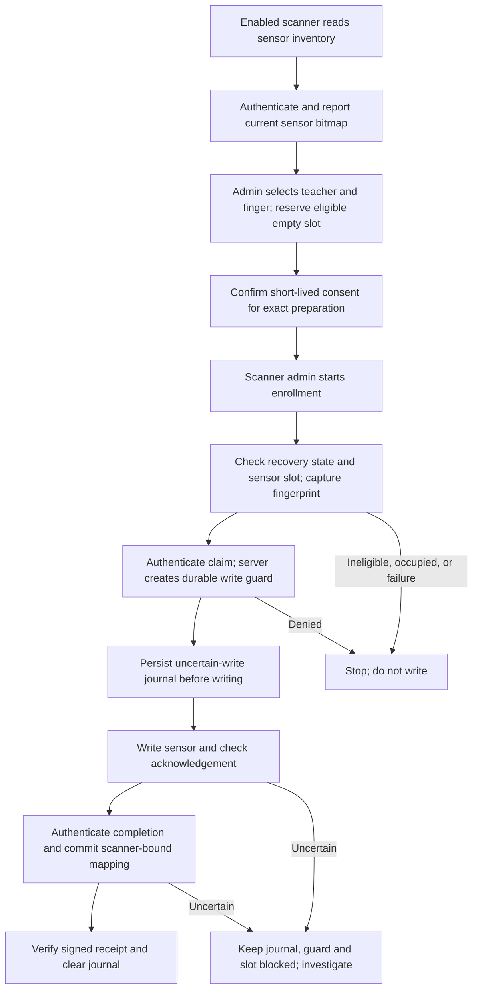
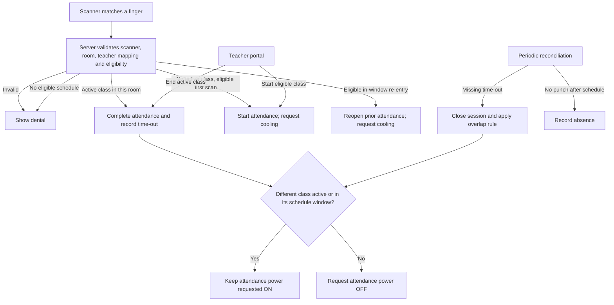
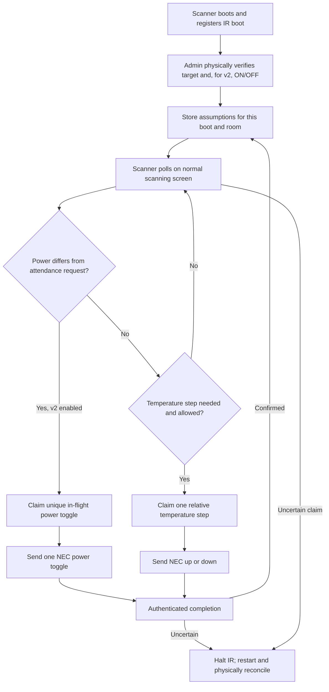
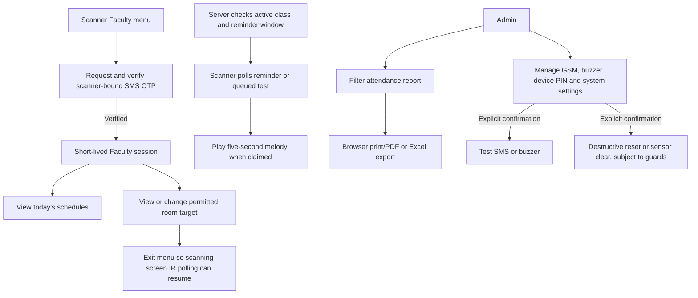

# SmartClass AC: comprehensive system flowchart

These diagrams describe the repository's portal and companion scanner source,
not proof that a particular deployment or device has been updated or tested.
Each diagram continues the system overview at a workflow boundary. Mermaid
rendering is supported by many Markdown viewers. See the [portal flow](./PORTAL_PROCESS_FLOW.md),
[firmware flow](./FIRMWARE_PROCESS_FLOW.md), [data model](./DATA_MODEL.md), and
[README](../README.md) for details, requirements, and limitations.

## 1. System overview

## 2. Startup and access

## 3. Teacher registration and mobile verification

`FacultyOtp:Secret` and a configured GSM modem are required. Modem acceptance
is not proof of delivery. Existing numbers are not retroactively verified;
demo seeding does not use this portal workflow.

## 4. Academic setup, scanner provisioning and pairing

Sensitive scanner protocols also require the per-device key, corresponding
server feature flags, and HTTPS outside Development.

## 5. Guarded fingerprint enrollment

Enrollment depends on enabled scanner build flags, portal gates and keys.
Inventory expires and is invalidated on protected operations. Same-slot
replacement has separate gates and incomplete recovery limitations; never
clear a guard or block simply to retry.

## 6. Attendance and room demand

The ending class's own remaining window does not keep its AC on after early
logout. Portal room status is not a measurement of the actual AC.

## 7. IR synchronization and attendance power

IR uses separate portal and scanner gates; enabling portal power control
disables legacy IR routes. A power command is a **toggle**, not distinct ON
and OFF codes. A diagnostic receiver or acknowledgment cannot confirm that the
AC received the signal. Manual remote use and missed signals can cause drift.
Remote and Override controls do not request IR power toggles.

## 8. Faculty menu, reminders, reports and maintenance

Reminder and test claims do not prove sound played. Device clear and reset are
destructive operations, not troubleshooting shortcuts.
